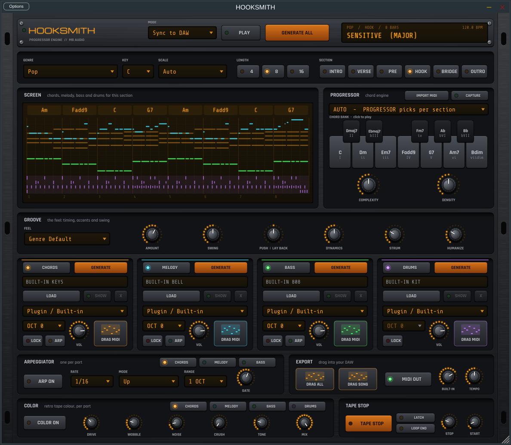

# HOOKSMITH — Free Song Idea Generator by MB Audio
### with the PROGRESSOR chord engine



HOOKSMITH writes **chords, melodies, bass lines and drums** for 17 genres and every part of a song, then plays them in time with Ableton through your own instruments. It's built like FLIPSIDE: same hardware look, and it loads other instruments inside itself. FLIPSIDE can also load HOOKSMITH.

**Genres:** Pop, Dance Pop, Pop Rock, Classical, Cinematic, House / EDM, Future Bass, Trance, Hip Hop (Boom Bap), Trap, Drill, R&B, Neo-Soul, Lo-Fi, Gospel, Afrobeats, Reggaeton.

**Sections:** Intro, Verse, Pre-Chorus, Hook, Bridge, Outro, at **4, 8 or 16 bars**. Intro and Outro use the Hook's chords, so the parts of a song fit together.

---

## Download (free)

Click the zip for your computer to download it (or see **[all releases](https://github.com/Maxswell5412/HOOKSMITH-VST/releases/latest)**):

| Computer | File | Formats |
|---|---|---|
| Mac (Apple Silicon + Intel) | **[⬇ HOOKSMITH-Mac.zip](https://github.com/Maxswell5412/HOOKSMITH-VST/releases/latest/download/HOOKSMITH-Mac.zip)** | AU + VST3 |
| Windows (64-bit) | **[⬇ HOOKSMITH-Windows.zip](https://github.com/Maxswell5412/HOOKSMITH-VST/releases/latest/download/HOOKSMITH-Windows.zip)** | VST3 |
| Linux (64-bit) | **[⬇ HOOKSMITH-Linux.zip](https://github.com/Maxswell5412/HOOKSMITH-VST/releases/latest/download/HOOKSMITH-Linux.zip)** | VST3 + standalone app |

Each zip has a short **Install** text inside. Works in Ableton Live, FL Studio, Logic Pro (AU), Bitwig, REAPER and more.

## Free forever, support the culture

HOOKSMITH is free, with no trial, no sign-up and nothing locked. Use it on anything you make, including commercial releases.
If it helps your music and you want to keep new plugins coming, hit the **Sponsor** button at the top of this page. Any amount helps.

## Build it yourself

```
cmake -B build -DCMAKE_BUILD_TYPE=Release
cmake --build build -j8
```
Needs CMake 3.22+ and a C++17 compiler (Xcode on Mac, Visual Studio 2022 on Windows, GCC/Clang on Linux; Linux also needs the ALSA/X11/FreeType dev packages listed in `.github/workflows/build.yml`). JUCE downloads automatically.

---

## Quick start

1. Drag **HOOKSMITH** onto a MIDI track.
2. Pick a **Genre**, a **Key**, a **Section** (Hook to start) and a **Length**.
3. Press play in Ableton, or press **PLAY** on HOOKSMITH. You'll hear the built-in sketch sounds right away.
4. Hit **GENERATE** until you like the idea. **New** on a part rewrites just that part. **Lock** keeps a part when you hit GENERATE.
5. Load your own sounds: press **Load** on a part (Chords, Melody, Bass, Drums) and pick Omnisphere, Serum, FLIPSIDE, a drum sampler, and so on.
6. Drag a **DRAG MIDI** tile into Ableton to drop the part as a clip. **DRAG ALL** drops every part. **DRAG SONG** drops a full 64-bar song (Intro, Verse, Pre, Hook, Verse, Pre, Hook, Bridge, Hook, Outro). Clicking a tile saves the file to **Music/HOOKSMITH** instead.

---

## New in v0.3
- **MACHINE (in COLOR):** give any part the sound *and* swing of a classic sampler: **MPC60, MPC2000, MPC3000 or SP-1200**. Each one has its own converter (sample rate and bits), filters, EQ voicing and saturation, plus its classic swing.
  - **FLAVOR** sets how much of the machine you hear and feel.
  - **EXAGGERATE** pushes it past the real specs: lower rate, fewer bits, harder swing, narrower filters.
  - **FUNK** loosens it up: lazy snares, pushed kicks, random accents and ghost notes, and a filter that wanders.
  - The level is matched automatically, so a machine changes the character, not the volume.
- **Memory slots (Melody and Bass):** four slots next to the display. Click an empty slot to keep what's playing, click a saved one to bring it back, right-click to replace or clear. Saved with your project.
- **LENGTH dial** on every part (short and choppy to long and smooth).
- **GENERATE takes:** a new idea, then two close takes of it, then something completely different.
- **Built-in sounds:** pianos, pads, strings, plucks, organ, leads, 808, sub, Reese and more. Auto picks a sound for the genre, or click a part's display to choose.
- Bass lines now jump an octave now and then, like real players do.
- Fixed: turning on an arp could crash Ableton.

## New in v0.2
- **GROOVE module**: 10 feels (Tight, Laid Back, Pushed, Dilla, Shuffle, Bounce, Afro/Dembow, Live Drummer, Rubato, or the genre's default) plus Amount, Swing, Push/Lay Back (pocket), Dynamics, Strum and Humanize. This is what takes away the robotic feel.
- **Per-part GENERATE**: every part (Chords, Melody, Bass, Drums) has its own GENERATE that rewrites only that part, even when it's locked. **GENERATE ALL** at the top skips locked parts. New drums give a new beat in the same style, and the 808 follows the new kick.
- **An arpeggiator on every part**: Chords, Melody and Bass each have their own ARP button. The ARPEGGIATOR panel shows whichever part you select.
- **COLOR** (RC-20 style) on each part: Drive (tape saturation), Wobble (wow and flutter), Noise (hiss and crackle), Crush (bits and sample rate), Tone and Mix. The part's screen shows "COLOR" when it's on.
- **TAPE STOP** on the whole output: hold the button to slow down to a stop and let go to spin back up. LATCH makes it click-on/click-off, and LOOP END stops automatically at the end of every loop. STOP and START set the speeds, and everything can be automated in Ableton.
- **IMPORT MIDI**: click Import MIDI, or drag .mid files onto HOOKSMITH. It finds the key and the chords, plays them in your key and genre with new melody, bass and drums, and puts the chords on the pads. Imports are saved with your project.
- **CAPTURE (Cthulhu packs)**: pack MIDI files for Cthulhu contain only one trigger note per chord, and the chords live inside the Cthulhu preset. Load Cthulhu on the CHORDS part, pick a pack preset, press CAPTURE. HOOKSMITH records the chord on every key. Then the pads play those chords, Chord Keys plays each key's exact chord, and importing that pack's trigger MIDI files gives real progressions.
- **Resizable window**: drag the bottom-right corner. It opens scaled to fit your screen.

---

## What everything does

| Section | How to use it |
|---|---|
| **MODE** | **Sync to DAW**: plays along with Ableton's transport (and you can play your instrument live over it). **Hold a Key**: the idea plays while you hold a note, transposed to that note. **Chord Keys**: every key plays a full chord from the chord bank, like Cthulhu but with the chords already built in. |
| **PROGRESSOR** | **AUTO** picks a progression for each section by itself. You can also choose one of the genre's named progressions (6–14 per genre, 153 in total). |
| **Chord bank** | 12 pads laid out like a keyboard. White keys are the scale's own chords, and black keys are borrowed "colour" chords (in C major: D, Eb, Fm, Ab, Bb). They follow your genre, key and Complexity. Click to hear them. In Chord Keys mode, any C key plays pad C, any D key plays pad D, and so on, in every octave. |
| **Complexity** | Low gives plain triads. High gives 7ths, 9ths, 11ths and 13ths, plus more variation the second time round. |
| **Density** | How many notes and hits. |
| **Groove** | Swing. The middle setting is the genre's own feel (Boom Bap and Lo-Fi swing hard, Trap is straight). Turn left for straight and right for extra swing. |
| **Humanize** | Small timing and velocity changes so it sounds played. |
| **Parts** | Each of the 4 parts has an on/off switch, its own instrument slot, **Sound** (your plugin, the built-in sound, or MIDI out only), octave, volume, **New**, **Lock** and a drag tile. |
| **Arpeggiator** | Plays the Chords part (and the chord pads and Chord Keys) note by note. It has straight, **triplet** and dotted rates, 5 modes, 1–4 octaves and a Gate control. |
| **MIDI Out** | Also sends the notes out as MIDI: chords on channel 1, melody on 2, bass on 3, drums on 10. |
| **Built-in / Tempo** | The volume of the built-in sounds, and the tempo used when no DAW is running (standalone app). |

**Drums** use the standard Drum Rack / General MIDI notes: kick C1 (36), snare D1 (38), clap D#1 (39), closed hat F#1 (42), open hat A#1 (46), crash C#2 (49). Any Ableton Drum Rack kit plays them correctly.

Everything is saved with your Ableton set, including the exact idea, the locks and the loaded instruments.

---

## Using it with FLIPSIDE

- **HOOKSMITH inside FLIPSIDE:** in FLIPSIDE, click **Load Instrument** and pick `HOOKSMITH.component` from **Macintosh HD → Users → (you) → Library → Audio → Plug-Ins → Components**. FLIPSIDE passes Ableton's tempo through, so it stays in sync. FLIPSIDE's macros and morph then control HOOKSMITH's knobs (Complexity, Density, Groove, Genre...). Don't turn on FLIPSIDE's own arp at the same time as HOOKSMITH's.
- **FLIPSIDE inside HOOKSMITH:** press **Load** on a part and pick `FLIPSIDE.component`. Then load your synth inside FLIPSIDE. HOOKSMITH writes the notes and FLIPSIDE flips the sound.

## MIDI out to other tracks
On another MIDI track, set **MIDI From** to the HOOKSMITH track. If your Ableton version doesn't list HOOKSMITH there, use the drag tiles or the instrument slots instead. They always work.

---

## Files
| File | What it is |
|---|---|
| `Source/Genres.cpp` | The genre library: progressions, chord rhythms, melody feel, bass and drum patterns. Edit this to add your own. |
| `Source/Music.cpp` | The composer: PROGRESSOR, voice leading, melody, bass and drums |
| `Source/PluginProcessor.*` | Playback, modes, arp, instrument hosting, MIDI out and export |
| `Source/PluginEditor.*`, `Source/UIKit.*` | The interface (same look as FLIPSIDE) |
| `Source/SketchSynth.h` | Built-in sounds: pianos, pads, strings, plucks, organ, leads, basses and drum kit |
| `Source/ColorFX.h` | COLOR strip and TAPE STOP |
| `Tests/` | Automated tests: `cmake --build build --target HooksmithEngineTests` and `HooksmithPluginTests` |

## Licence
Free and open source under the **GNU AGPLv3** (see `LICENSE`), built with [JUCE](https://juce.com). The music you make with HOOKSMITH is 100% yours.
All chords, progressions and patterns are generated from music theory. Nothing from third-party preset packs is included.
